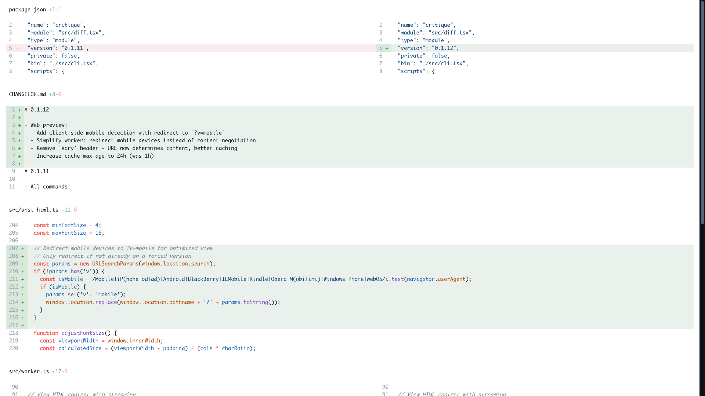

<div align='center'>
    <br/>
    <br/>
    <h3>critique</h3>
    <p>Beautiful diff viewer for terminals, web previews, and agents.</p>
    <br/>
    <br/>
</div>


## Installation

critique requires [Bun](https://bun.sh). It does not run under Node.js.

```bash
# Run directly without installing
bunx critique

# Or install globally
bun install -g critique
```

## Quick Start

Open the current working tree diff in the terminal:

```bash
critique
```

Upload the same diff and get a shareable URL:

```bash
critique --web "Current working tree"
```

Share a GitHub pull request directly, from any directory:

```bash
critique https://github.com/remorses/sigillo/pull/19 --web "Sigillo PR #19"
```

Review staged changes:

```bash
critique --staged
critique --staged --web "Staged changes"
```

## Core Diff Commands

critique follows the same mental model as `git diff`.

A GitHub PR URL fetches the pull request diff from the GitHub API. Public PRs work without login. For private PRs, use `gh auth login`, `GH_TOKEN`, or `GITHUB_TOKEN`. The URL also works with `--pdf`, `--image`, `--filter`, or in the terminal viewer.

```bash
# View unstaged changes, including untracked files
critique

# View staged changes
critique --staged

# View changes since a ref
critique HEAD~1
critique main

# View one commit only
critique --commit HEAD~1
critique --commit abc1234

# Compare two refs, PR style
critique main HEAD
critique main feature-branch

# Watch the working tree and refresh on changes
critique --watch

# Add experimental call-stack changes to the file tree
critique --calldiff

# Filter files by glob pattern
critique --filter "src/**/*.ts"
critique --filter "src/**/*.ts" --filter "lib/**/*.js"
```

## Which Commits a Diff Contains

Whenever a diff spans commits, critique lists them before the diff or the URL.

```
3 commits, 22 files, +1573 -311

  2a09302  Correct the identity docs, and mark the release minor
  1fb8af7  Give every element a stable GPUI identity
  7998490  Launch a window without stealing focus
  base: f948f50  Reclaim the style table when the tree shrinks

  + uncommitted working tree changes
```

This matters because a **rebased branch can carry commits replayed from another
branch**. The merge base is then too far back, and a shared link silently includes
work you did not write. If a listed commit is not yours, pass the first commit of
**your own work** as the base:

```bash
# Wrong: the merge base pulls in a commit a rebase replayed onto the branch
critique f948f50 --web "Element identity"

# Right: start from your own first commit
critique 7998490 --web "Element identity"
```

Long ranges are truncated, but the **oldest commits are always kept**, because a rebase
replays a foreign commit right above the base. Silence the list in scripts with
`--no-commit-list`. With `--json` it goes to stderr and the commits are added to the
JSON payload instead.

### Diverged Branches

`critique A..B` and `critique <ref>` compare two trees directly. On **diverged**
branches such a diff also **undoes** every commit that exists only on the base side.
Those commits are part of the diff, so critique lists them too:

```
1 commit added, 1 commit reversed, 2 files, +1 -1

  added by right:
    a279fbe  Only on right

  reversed from left:
    d395611  Only on left

  ! left and right have diverged, so this diff also undoes the commits above.
```

`critique A...B` and `critique A B` start at the **merge base** instead, so they never
reverse anything, and the `base:` line names the merge base rather than the ref.

Plain unstaged and `--staged` diffs contain no commits, so nothing is printed.

## Call-stack Diffs

`--calldiff` uses [calldiff](https://github.com/tanishqkancharla/calldiff) to show how function calls changed. Each changed call tree appears below its source file in the top file tree.

```bash
# Working tree call changes
critique --calldiff

# Changes since a ref
critique main --calldiff

# PR-style comparison and web preview
critique main HEAD --calldiff --web "Call flow changes"

# One commit
critique --commit HEAD --calldiff
```

The feature is experimental. calldiff uses Tree-sitter and can install a language grammar through npm on first use. `--staged`, `--stdin`, and `--watch` are not supported with `--calldiff`.

Set `CRITIQUE_CALLDIFF=1` to enable call-stack diffs by default:

```bash
export CRITIQUE_CALLDIFF=1
critique
```

## Navigation

| Key | Action |
| --- | --- |
| `↑` / `↓` | Scroll up and down |
| `p` | Open file selector dropdown |
| `t` | Open theme picker |
| `Option` held | Fast scroll at 10x speed |
| `g` `g` / `G` | Jump to top / bottom |
| `Ctrl+D` / `Ctrl+U` | Half page down / up |
| `q` / `Esc` | Quit / close overlay |

## Web Previews

`--web` renders the diff with the same terminal renderer, uploads it to [critique.work](https://critique.work), and prints a shareable URL.

```bash
# Working tree changes
critique --web "Fix auth retry"

# Staged changes
critique --staged --web "Release notes"

# Changes since a ref
critique main --web "Branch changes"

# One commit
critique --commit HEAD --web "Latest commit"

# PR-style branch diff
critique main HEAD --web "Current branch"

# Pull request from GitHub (no checkout needed)
critique https://github.com/remorses/sigillo/pull/19 --web "Sigillo PR #19"

# JSON output for scripts
critique --web "Deploy changes" --json
```

Generated URLs look like `critique.work/v/<id>`.



### Web Preview Options

| Flag | Description | Default |
| --- | --- | --- |
| `--web [title]` | Generate and upload a web preview | `Critique Diff` |
| `--staged` | Show staged changes | none |
| `--commit <ref>` | Show changes from a specific commit | none |
| `--calldiff` | Add experimental call-stack changes to the file tree | off |
| `--cols <n>` | Desktop render width | `240` |
| `--mobile-cols <n>` | Mobile render width | `100` |
| `--filter <pattern>` | Filter files by glob, can be repeated | none |
| `--theme <name>` | Use a fixed theme instead of auto light and dark mode | none |
| `--no-commit-list` | Do not list the commits contained in the range | off |
| `--open` | Open the URL in your browser | none |
| `--json` | Print `{ url, id, curl, files, commits }` for scripts | none |
| `--password <pw>` | Encrypt the link end to end with a password (or set `CRITIQUE_PASSWORD`) | none |

### Password Protected Links

Add a **password** to encrypt the link end to end. The CLI encrypts the HTML and the patch on your machine before upload. critique.work only stores ciphertext and never receives the password, so **nobody but the people you give the password to can read the diff**. That includes me, the person who runs critique.work, and Cloudflare, which hosts it. Viewers type the password once and their browser decrypts.

```text
your machine                     critique.work                        viewer's browser
────────────                     ─────────────                        ────────────────
diff ─► gzip ─► AES-256-GCM ───► stores ciphertext only ───────────► password ─► decrypt
        key = PBKDF2(password)   no password, no key, no hash
```

```bash
critique --web --password 'a long passphrase only you share'

# or for every upload
export CRITIQUE_PASSWORD='a long passphrase only you share'
critique --web
```

The browser remembers every password that worked, so one password unlocks all diffs you share with it. Protected links have no social preview image.

Agents read the patch with **curl**. The CLI prints the command after upload. It sends a key that opens only this diff, never the password:

```bash
curl -b 'critique_key=<key>' 'https://critique.work/v/<id>.patch'
```

> [!WARNING]
> Anyone who gets the encrypted upload can try to guess the password offline. Use 12 characters or more. A lost password cannot be recovered.

### How Web Uploads Work

```text
┌─────────────────────────────────────┐
│ git diff / GitHub PR diff           │
└─────────────────────────────────────┘
                   │
                   ▼
┌─────────────────────────────────────┐
│ opentui test renderer               │
└─────────────────────────────────────┘
                   │
                   ▼
┌─────────────────────────────────────┐
│ HTML variants and raw patch         │
└─────────────────────────────────────┘
                   │
                   ▼
┌─────────────────────────────────────┐
│ critique.work upload                │
└─────────────────────────────────────┘
                   │
                   ▼
┌─────────────────────────────────────┐
│ shareable URL, optional .patch      │
└─────────────────────────────────────┘
```

The CLI does **not** generate a local HTML file. It uploads to `critique.work`. Local HTML export is tracked separately in [issue #42](https://github.com/remorses/critique/issues/42).

Uploaded diffs expire after 7 days unless you use a license key. Identical diffs reuse the same content hash URL.

### Privacy and Terms

critique.work is run by Tommaso De Rossi ([remorses](https://github.com/remorses)). Anyone with a link can open a public diff, so do not upload secrets. Use `--password` when the operator of critique.work must not be able to read the diff either: password links are end-to-end encrypted. Delete an upload with `critique unpublish <url>`.

- [Privacy policy](https://critique.work/privacy): what is stored, for how long, and how to delete it
- [Terms of service](https://critique.work/terms)

## Raw Patch Access

Every `--web` upload also stores the raw unified diff. Append `.patch` to any critique URL to fetch it.

```bash
CRITIQUE_URL='https://critique.work/v/<id>'

# View the patch in your terminal
curl "$CRITIQUE_URL.patch"

# Apply the patch directly to your repo
curl -s "$CRITIQUE_URL.patch" | git apply

# Reverse the patch
curl -s "$CRITIQUE_URL.patch" | git apply --reverse
```

## Git Difftool Integration

Configure critique as your git difftool:

```bash
git config --global diff.tool critique
git config --global difftool.critique.cmd 'critique difftool "$LOCAL" "$REMOTE"'
```

Then run:

```bash
git difftool HEAD~1
```

## Lazygit Integration

Use critique as a custom pager in [lazygit](https://github.com/jesseduffield/lazygit):

```yaml
# ~/.config/lazygit/config.yml
git:
  pagers:
    - pager: critique --stdin
```

For details, see [lazygit's Custom Pagers documentation](https://github.com/jesseduffield/lazygit/blob/master/docs/Custom_Pagers.md).

## Pick Files from Another Branch

`critique pick` lets you apply selected files from another branch to the current checkout.

```bash
critique pick feature-branch
```

Selected files are applied as patches. Deselected files are restored.

## Selective Hunk Staging

`critique hunks` gives scripts and agents a stable alternative to `git add -p`.

```bash
# List unstaged hunks with stable IDs
critique hunks list

# List staged hunks
critique hunks list --staged

# Filter by file pattern
critique hunks list --filter "src/**/*.ts"

# Stage one hunk by ID
critique hunks add 'src/main.ts:@a1b2c3d4e5f6'

# Stage multiple hunks
critique hunks add 'src/main.ts:@a1b2c3d4e5f6' 'src/utils.ts:@f6e5d4c3b2a1'
```

Hunk IDs use this format:

```text
file:@<hash>
file:@<hash>.1
file:@<hash>.2
```

The hash is from the hunk's added and removed lines, not the `@@` line numbers. Unrelated edits above or below the hunk do not change the ID. Duplicate payloads in the same file get `.1`, `.2`, and so on. Old `file:@-oldStart,...` IDs are no longer accepted.

`critique hunks list` still prints the `@@` header under each ID, so you can see where the hunk sits in the file.

## E-Ink Reading

Generate PDFs from diffs to read on Kindle or Boox e-readers.

```bash
critique --pdf
critique main --pdf --open
```

The PDF preserves syntax highlighting and diff formatting. Email it to your Kindle, drop it in BooxDrop, or save it to a synced Google Drive folder. See [docs/e-reader-guide.md](docs/e-reader-guide.md) for setup details.

## Agent Skill

This package ships a skill file that teaches AI coding agents how to use critique for diff URLs, PDFs, images, and selective hunk staging.

```bash
npx -y skills add remorses/critique -g -y
```

## Features

- **Syntax highlighting:** powered by [Tree-sitter](https://tree-sitter.github.io/) via [opentui](https://github.com/sst/opentui)
- **Split view:** side-by-side comparison for wide terminals, unified view on narrow terminals
- **Word-level diff:** highlights exact word changes inside modified lines
- **File navigation:** quick file switcher with fuzzy search
- **Click to open:** click line numbers to open in your editor with `REACT_EDITOR`
- **Watch mode:** refreshes as you edit files
- **Web previews:** hosted shareable URLs on [critique.work](https://critique.work)
- **Raw patches:** every web preview has a `.patch` endpoint
- **PDF output:** optimized for code review away from the terminal

## Supported Languages

TypeScript, JavaScript, TSX, JSX, JSON, Markdown, HTML, CSS, Python, Rust, Go, Java, C, C++, C#, Ruby, PHP, Scala, Haskell, Julia, OCaml, Clojure, Swift, Nix, YAML, and Bash.

## Configuration

| Environment Variable | Description | Default |
| --- | --- | --- |
| `REACT_EDITOR` | Editor command for click-to-open | `zed` |
| `CRITIQUE_WORKER_URL` | Custom worker URL for web previews | `https://critique.work` |
| `CRITIQUE_PASSWORD` | Password for every `--web` upload; `--password` overrides it | none |

## Ignored Files

Lock files are automatically hidden from diffs:

- `pnpm-lock.yaml`
- `package-lock.json`
- `yarn.lock`
- `bun.lockb`
- `bun.lock`
- `Cargo.lock`
- `poetry.lock`
- `Gemfile.lock`
- `composer.lock`

Files with more than 6000 lines of diff are also hidden for performance.

## Built With

- [opentui](https://github.com/sst/opentui): React-based terminal UI framework
- [Tree-sitter](https://tree-sitter.github.io/): syntax highlighting
- [diff](https://github.com/kpdecker/jsdiff): diff algorithm
- [Hono](https://hono.dev/): web framework for the preview worker

## Sponsors

<a href="https://coderabbit.link/remorses" target="_blank" rel="noopener noreferrer">
  
</a>

Sponsored by [CodeRabbit](https://coderabbit.link/remorses).

## License

MIT
